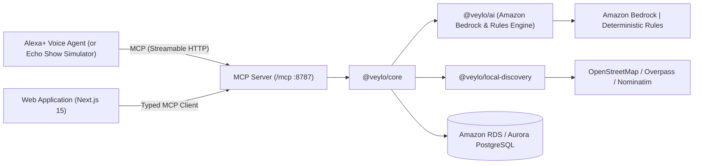

<div align="center">

# Veylo

### Turn ambiguous human requests into concrete real-world shopping actions.

[](https://www.typescriptlang.org/)
[](https://nextjs.org/)
[](https://modelcontextprotocol.io/)
[](https://aws.amazon.com/bedrock/)
[](https://aws.amazon.com/polly/)
[](https://aws.amazon.com/rds/)
[](LICENSE)

<p align="center">
  <b>See it. Say it. Find it.</b><br/>
  An ambient voice agent capability exposed over the Model Context Protocol (MCP).
</p>

</div>

---

## The Problem: The Ambiguity Gap

When people need physical objects, they rarely know the technical product names:
> *"I need that little thing that lets me connect my laptop to the TV. I don't know what it's called."*  
> *"I need the white tape plumbers use around pipe threads."*  
> *"I need a cable to charge my phone."*

Traditional search engines fail because they require precise keywords. Generic chat models fail because they hallucinate local store inventory, hours, and availability.

**Veylo bridges the ambiguity gap.** It functions as a composable agent capability that turns vague human descriptions into verified physical-world actions:
```text
UNKNOWN REQUEST ──► PRODUCT HYPOTHESES ──► CATEGORY MAPPING ──► REAL-WORLD STORES ──► EVIDENCE VERIFICATION ──► DIRECTIONS & CONTACT
```

---

## Core Differentiators & Architecture

### 1. Progressive Agent Trace (SSE Streaming)
Veylo does not hide agent reasoning behind a black box or render a static trace after the fact. Planner decisions are streamed live over **Server-Sent Events (SSE)** from the MCP server to the client. Users and evaluators can watch the agent reason in real time: step numbers, tool calls, input/output summaries, confidence changes, and evidence additions with subtle, polished animations.

### 2. Ambient Hardware Compatibility & Inventory Memory
Veylo retains memory of user devices and owned inventory across sessions (`user_devices` and `user_inventory`):
- **Hardware Deductions:** When a user requests an adapter for their laptop, Veylo detects their registered MacBook Pro (M3) and infers **USB-C** connector compatibility automatically.
- **Redundant Purchase Prevention:** If the user already owns the item, Veylo catches it before purchase: *"You already own a USB-C to HDMI adapter in your inventory. Do you need a second one?"*

### 3. Evidence-First Trust Model (Zero Hallucinated Stock)
Every local store result carries an explicit, tamper-proof inventory trust state:
- `CONFIRMED`: Real-time verified physical stock within 24 hours.
- `LIKELY`: Category fit with verified first-party retailer catalog listing.
- `WEB_FOUND`: Web mention without direct stock confirmation.
- `UNKNOWN`: Plausible retailer, but zero product-level stock evidence.

Veylo's schemas reject any claim of `CONFIRMED` stock without attached physical evidence. It never fabricates prices, opening hours, or inventory.

### 4. Self-Hosted MCP Server (Spec 2025-11-25)
Veylo exposes **11 composable tools** via stateless Streamable HTTP on `http://127.0.0.1:8787/mcp`, fully compliant with the latest Model Context Protocol specification. Both the Next.js web application and external voice agents (Alexa+) call the exact same MCP tools.

### 5. Native AWS Cloud Intelligence & Zero-Broken-Demo Guarantee
- **Amazon Bedrock:** Production-grade semantic reasoning using Anthropic Claude 3.5 Sonnet and Amazon Nova via the modern unified `ConverseCommand` API.
- **Resilient Fallback:** Automatically switches to deterministic offline rules if AWS credentials are unset or rate-limited. Zero broken sessions during evaluation.

### 6. Alexa+ Luminary Avatar & Amazon Polly Neural Voice Synthesis
- **Calm Notion/Linear Aesthetic:** Thoughtfully designed UI emphasizing typography, crisp hierarchy, restrained neutral palettes, and truthful status indicators.
- **Dynamic Luminary Avatar:** Real-time multi-state status indicator with responsive orbital light physics (`idle`, `listening`, `thinking`, `speaking`).
- **High-Fidelity Neural Audio:** Ultra-low latency voice streaming via **Amazon Polly** (`@aws-sdk/client-polly` with "Joanna" Alexa-style neural voice) paired with smart automated fallback to system natural neural voices (`Microsoft Jenny Natural`, `Aria`, `Google US English`).
- **Echo Show Simulation:** Dedicated multimodal canvas providing simultaneous visual summary cards and conversational audio playback.

---

## System Architecture



### Monorepo Structure

```text
veylo/
├── apps/
│   ├── mcp-server/       # Model Context Protocol server (Streamable HTTP, port 8787)
│   └── web/              # Next.js 15 App Router frontend (Tailwind CSS, Echo Show simulator)
├── packages/
│   ├── agent/            # Bounded agent loop (max 8 steps) with progressive trace streaming
│   ├── ai/               # AI engine (Amazon Bedrock Converse API, deterministic rules)
│   ├── core/             # Domain services, catalog index, and evidence verification engine
│   ├── db/               # PostgreSQL & Amazon RDS persistence with Drizzle ORM migrations
│   ├── local-discovery/  # Real-world geocoding & OpenStreetMap Overpass spatial queries
│   ├── mcp-client/       # Typed MCP client implementation
│   └── types/            # Zod schemas & tool contracts (single source of truth)
└── docs/                 # Architectural specifications and evaluation guides
```

---

## Quickstart

### 1. Prerequisites
- **Node.js:** `>= 22`
- **Package Manager:** `pnpm` (`npm install -g pnpm`)
- **Docker:** (Optional, for local PostgreSQL)

### 2. Setup & Installation
```bash
# Clone the repository
git clone https://github.com/NOBA235/veylo.git
cd veylo

# Install monorepo dependencies
pnpm install

# Initialize environment variables
cp .env.example .env

# Bootstrap database (applies migrations and seeds catalog)
pnpm bootstrap
```
*(If running without Docker, simply supply your PostgreSQL or Amazon RDS connection string as `DATABASE_URL` in `.env` and run `pnpm db:migrate && pnpm db:seed`.)*

### 3. Start Development Servers
```bash
# start mcp server
pnpm.cmd --filter @veylo/mcp-server dev

pnpm dev
```
- **Web Application:** `http://localhost:3000`
- **MCP Server:** `http://127.0.0.1:8787/mcp`
- **Health Telemetry:** `http://localhost:3000/api/health`

---

## Verification & Testing

Veylo includes strict automated test suites across all packages:

```bash
# Run all automated unit & integration tests
pnpm test

# Run strict TypeScript checks across the monorepo
pnpm typecheck

# Verify MCP protocol compliance against the running server
pnpm mcp:conformance

# Inspect MCP tools using the official Model Context Protocol Inspector
npx @modelcontextprotocol/inspector http://127.0.0.1:8787/mcp
```

---

## Documentation

- **[System Architecture](docs/architecture.md):** Deep dive into the bounded agent loop, ports, and monorepo design.
- **[AWS Cloud Integration](docs/aws-builder-integration.md):** Amazon Bedrock, Amazon Polly Neural Voice, and Amazon RDS architecture.
- **[MCP Tools Specification](docs/mcp-tools.md):** Schema contracts and execution documentation for all 11 tools.
- **[Evidence Trust Model](docs/evidence-model.md):** Verification hierarchy, confidence scoring, and anti-hallucination rules.
- **[Alexa+ Integration Guide](docs/alexa-plus-integration.md):** Ambient voice dialogue design, system prompts, and Echo Show 10 multimodal canvas.
- **[Evaluation & Walkthrough Guide](docs/evaluation-guide.md):** Step-by-step evaluator scenarios for testing real-time trace and inventory memory.
- **[Developer Friction Log](docs/friction-log.md):** Engineering friction log detailing AWS SDK v3, Bedrock, and Polly integrations.
- **[Product Roadmap](docs/roadmap.md):** Forward-looking engineering vision including multimodal camera vision and retail POS webhooks.

---

## License

This project is licensed under the [MIT License](LICENSE).
