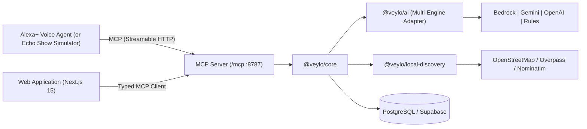

# System Architecture

Veylo turns ambiguous physical requests into concrete real-world actions through an inspectable, evidence-first agent loop exposed over the Model Context Protocol (MCP).

The web application and ambient voice agents use the exact same MCP tools. There is zero duplicate or synthetic logic between environments.

---

## 1. Bounded Agent Planner Loop

`observe -> decide -> call MCP tool -> update state -> repeat`

- **Hard Step Budget:** Maximum 8 tool calls per session (`@veylo/agent`).
- **Early Termination:** The planner stops dynamically as soon as high-confidence evidence is verified.
- **Ambiguity Gates:** Surfaces an inline clarification question only when ambiguity materially alters the outcome (e.g. top confidence < 0.75, candidate products in conflicting categories, missing location, or unknown connector compatibility).
- **Progressive Trace Streaming:** Planner decisions are streamed to consumers in real time using Server-Sent Events (SSE).

---

## 2. Product Identification Pipeline

1. **Exact Alias Matching:** Normalized string lookup against canonical aliases.
2. **Trigram Fuzzy Matching:** PostgreSQL trigram similarity scoring (`pg_trgm`) for typo tolerance and phonetic similarity.
3. **Category & Use-Case Deductions:** Semantic taxonomy navigation linking intent descriptors to canonical categories.
4. **Structured Generative Inference:** Configured LLM assist (Amazon Bedrock Claude 3.5 Sonnet / Google Gemini / OpenAI) for complex zero-shot natural language understanding.
5. **Deterministic Fallback:** Seamless zero-key fallback to offline rules engine ensures 100% system availability even without external API credentials.

Every external AI output is strictly validated against Zod schemas; schema violations or API rate limits automatically degrade to rule-based resolution without crashing the active session.

---

## 3. Data Architecture & Storage

- **DDL Source of Truth:** `packages/db/migrations/*.sql` manages schemas, extensions (`pg_trgm`, `uuid-ossp`), and GIN/trigram indexing.
- **Typed Schema Mirror:** `packages/db/src/schema.ts` provides compile-time type safety via Drizzle ORM.
- **Dual-Mode Persistence:** Fully compatible with local containerized PostgreSQL (`docker compose`) or cloud-hosted Supabase instances.
- **User Hardware & Inventory Memory:** `user_devices` and `user_inventory` tables enable cross-session hardware compatibility deductions (e.g. MacBook Pro M3 $\rightarrow$ USB-C) and prevent redundant purchases.
- **Bidirectional Relationship Graph:** Models symmetric relationships (`alternative`, `often_confused_with`) and directional dependencies (`replacement_for`, `used_with`, `compatible_with`).

---

## 4. Core Domain Services (`@veylo/core`)

All core business logic is decoupled from HTTP and transport layers behind strict ports:
- **Ports (`context.ts`):** `ProductRepository`, `PlaceSource`, `Geocoder`, `PlaceStore`, `InventoryEvidenceProvider`, `EvidenceLedger`, `UserContextStore`, and AI assist ports (`IdentifyAssist`, `CompareAssist`).
- **Services (`services.ts`):** Core handlers for all 11 MCP tools: `identify_product`, `search_products`, `discover_local_places`, `check_local_inventory`, `compare_products`, `get_place_details`, `get_directions`, `contact_store`, `search_web`, `create_shopping_list`, and `get_user_context`.
- **Catalogue Caching:** Catalog data is indexed in memory and refreshed on a configurable TTL.
- **Evidence-First Trust Verification:** Local inventory checks reject any `CONFIRMED` status lacking physical store verification.

---

## 5. Model Context Protocol Layer (`apps/mcp-server`)

- **Transport:** Implements the official Model Context Protocol (spec 2025-11-25) using stateless Streamable HTTP on `/mcp`.
- **Contract Synchronization:** Tools are registered directly from `@veylo/types` contracts (`toolContracts`), guaranteeing that runtime schemas, documentation, and TypeScript interfaces remain strictly synchronized.
- **Client Library (`@veylo/mcp-client`):** Typed client wrapper providing full loopback testing and error demarcation across network boundaries.
